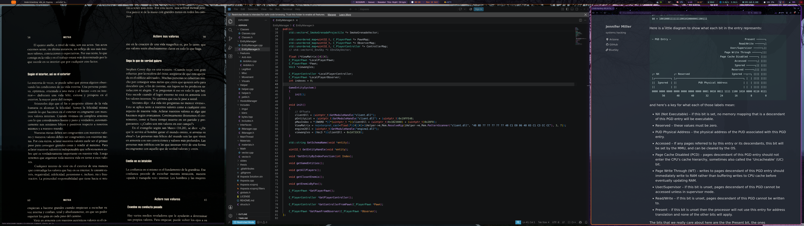

<div align="center">

# arch-niri

Arch Linux + niri dotfiles


</div>

<p align="center">
  
</p>

## Install

```sh
git clone https://github.com/Aspasia1337/arch-niri.git
cd arch-niri
./install.sh
```

Installs packages, symlinks configs, backs up existing ones. Log out and start a niri session.

## What's included

| Component | Config |
| --- | --- |
| [niri](https://github.com/YaLTeR/niri) | [`config.kdl`](rice/.config/niri/config.kdl) |
| [waybar](https://github.com/Alexays/Waybar) | [`config.jsonc`](rice/.config/waybar/config.jsonc) · [`style.css`](rice/.config/waybar/style.css) · [`scripts/`](rice/.config/waybar/scripts) |
| [alacritty](https://github.com/alacritty/alacritty) | [`alacritty.toml`](dotfiles/.config/alacritty/alacritty.toml) |
| [fuzzel](https://codeberg.org/dnkl/fuzzel) | [`fuzzel.ini`](dotfiles/.config/fuzzel/fuzzel.ini) |
| [mako](https://github.com/emersion/mako) | [`config`](rice/.config/mako/config) |
| [conky](https://github.com/brndnmtthws/conky) | [`conky.conf`](rice/.config/conky/conky.conf) |
| [swaylock-effects](https://github.com/jirutka/swaylock-effects) | [`config`](rice/.config/swaylock/config) |
| [ranger](https://github.com/ranger/ranger) | [`rc.conf`](rice/.config/ranger/rc.conf) |
| [zathura](https://pwmt.org/projects/zathura/) | [`zathurarc`](rice/.config/zathura/zathurarc) |
| [mpv](https://mpv.io) | [`mpv.conf`](rice/.config/mpv/mpv.conf) |
| gtk | [`gtk-3.0`](rice/.config/gtk-3.0/settings.ini) · [`gtk-4.0`](rice/.config/gtk-4.0/settings.ini) |

## GPU passthrough

Optional VFIO setup for discrete GPU passthrough to a Windows guest. See [`passthrough/README.md`](passthrough/README.md).
