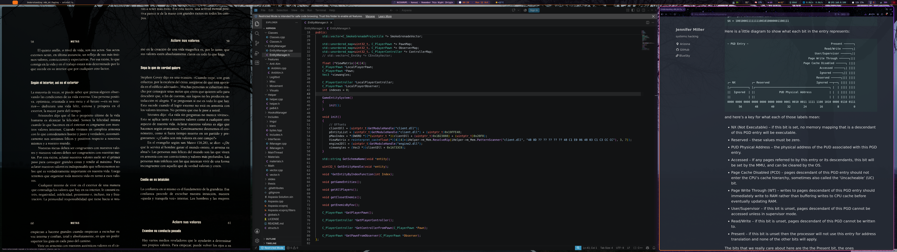

<div align="center">

# arch-niri

**Arch Linux + niri rice · green forest theme**

A scrollable-tiling Wayland desktop with a consistent forest palette, glass
effects, dynamic waybar, split audio visualizers and one-command setup.


[Install](#install) · [Desktop](#desktop) · [Waybar](#waybar) · [Palette](#palette) · [Dotfiles](#dotfiles) · [GPU passthrough](#gpu-passthrough)

</div>

<p align="center">
  
</p>

---

## Install

```sh
git clone https://github.com/Aspasia1337/arch-niri.git
cd arch-niri
./install.sh
```

The script installs all packages (pacman + AUR via `yay`/`paru`), symlinks configs into `~/.config/`, copies the wallpaper, and patches placeholders with your home path. Existing configs are backed up to `*.bak`. Log out and start a niri session.

---

## Desktop

**[niri](https://github.com/YaLTeR/niri)** — scrollable-tiling Wayland compositor. No CSD, 10 px rounded corners, green shadows, lime → forest focus-ring gradient. Transparent workspaces so the wallpaper shows through, including in the Overview. Floating windows get a green border. Resize with `Mod+Alt` + hjkl / numbers / wheel. Clipboard history with `cliphist` (`Mod+Shift+C`).
→ [`config.kdl`](rice/.config/niri/config.kdl)

**[swaybg](https://github.com/swaywm/swaybg)** — wallpaper in the backdrop layer, visible behind the Overview.
→ [`green.jpg`](assets/wallpapers/green.jpg)

**[mako](https://github.com/emersion/mako)** — notifications themed to the forest palette, per-app border colors (Spotify lime, Firefox blue), grouped display.
→ [`mako/config`](rice/.config/mako/config)

**[swaylock-effects](https://github.com/jirutka/swaylock-effects)** + **[swayidle](https://github.com/swaywm/swayidle)** — lock screen with blurred wallpaper, vignette, fade-in and a clock inside the ring. Auto-locks after 10 min with grace period, displays off shortly after, locks before suspend.
→ [`swaylock/config`](rice/.config/swaylock/config)

**[ranger](https://github.com/ranger/ranger)** — file manager with matching colorscheme and image previews via [ueberzugpp](https://github.com/jstkdng/ueberzugpp).
→ [`rc.conf`](rice/.config/ranger/rc.conf) · [`nightshade.py`](rice/.config/ranger/colorschemes/nightshade.py)

**[zathura](https://pwmt.org/projects/zathura/)** — document viewer, recolored to the palette.
→ [`zathurarc`](rice/.config/zathura/zathurarc)

**[mpv](https://mpv.io)** — media player with MPRIS.
→ [`mpv.conf`](rice/.config/mpv/mpv.conf)

---

## Waybar

Status bar with JetBrainsMono Nerd Font, translucent glass background, green accent border. Every module glows on hover and changes color dynamically (green → orange → red) based on thresholds.

Center: dual **cava** visualizers flanking the music player (mic input on the left in blue, speaker output on the right in green), clock and weather.

→ [`config.jsonc`](rice/.config/waybar/config.jsonc) · [`style.css`](rice/.config/waybar/style.css) · [`scripts/`](rice/.config/waybar/scripts)

| Module | What it shows |
| --- | --- |
| `cava` / `cava-r` | split audio visualizer — mic input (left) and speaker output (right) |
| `music` | now playing with progress bar, time, play/pause icons |
| `cputemp` / `gputemp` | CPU and GPU temps with dynamic color |
| `gpu` | GPU busy % and VRAM |
| `disk` | free space on root and secondary mount |
| `ip` | local and public IP |
| `uptime` | session uptime |
| `vms` | running libvirt domains |
| `mic` | microphone mute indicator with toggle |
| `updates` | pending pacman + AUR updates |
| `weather` | current conditions via wttr.in |

---

## Palette

| | Role | Hex |
| --- | --- | --- |
|  | Background | `#0a1208` |
|  | Foreground | `#e8f5d0` |
|  | Accent | `#8fd14f` |
|  | Lime | `#c6f36b` |
|  | Forest | `#2f7d3a` |
|  | Purple | `#9b30ff` |
|  | Orange | `#ff7518` |
|  | Red | `#ff1a3c` |

---

## Dotfiles

Shell and app config under [`dotfiles/`](dotfiles).

- **[Alacritty](https://github.com/alacritty/alacritty)** — GPU-accelerated terminal, translucent, no decorations → [`alacritty.toml`](dotfiles/.config/alacritty/alacritty.toml)
- **[fuzzel](https://codeberg.org/dnkl/fuzzel)** — app launcher, forest theme, green border → [`fuzzel.ini`](dotfiles/.config/fuzzel/fuzzel.ini)
- **[ueberzugpp](https://github.com/jstkdng/ueberzugpp)** — image preview backend for ranger → [`config.json`](dotfiles/.config/ueberzugpp/config.json)
- **[zsh](https://www.zsh.org/)** — with syntax highlighting, autosuggestions, git branch in prompt → [`.zshrc`](dotfiles/.zshrc)

---

## GPU passthrough

Optional VFIO setup for passing a discrete GPU to a Windows guest with full hypervisor hiding. The host keeps the card when no VM is running and hands it over on demand.

See [`passthrough/README.md`](passthrough/README.md) for the full write-up — PCI/IOMMU groups, SMBIOS spoofing, CPU pinning, the libvirt hook, and the VM definition.

---

## Layout

```
.
├── install.sh              one-command setup (packages + symlinks + wallpaper)
├── assets/
│   ├── desktop.png         screenshot
│   └── wallpapers/         desktop wallpaper(s)
├── rice/                   themed desktop
│   └── .config/            niri · waybar · swaylock · mako · ranger · zathura · mpv
├── dotfiles/               shell + app config
│   ├── .zshrc
│   └── .config/            alacritty · fuzzel · ueberzugpp
└── passthrough/            optional GPU passthrough (VFIO)
    ├── README.md
    ├── hooks/qemu
    └── vm/win11_gpu.xml
```
